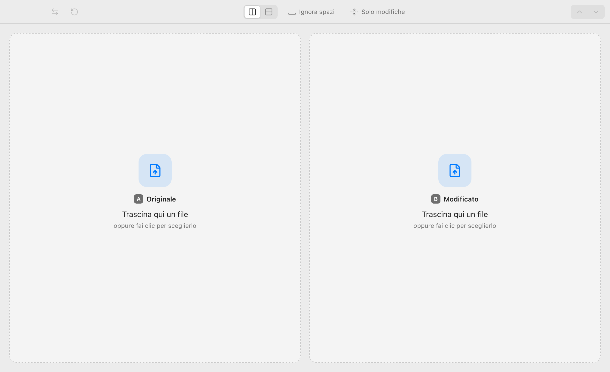
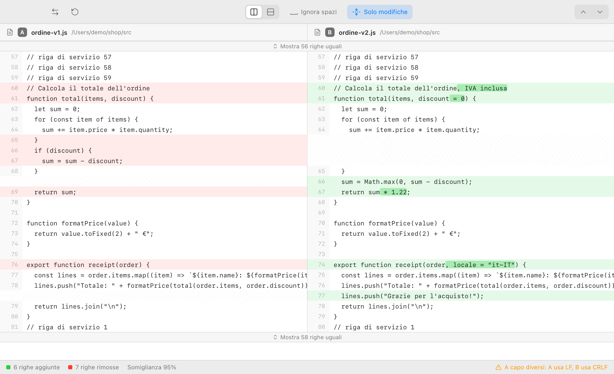
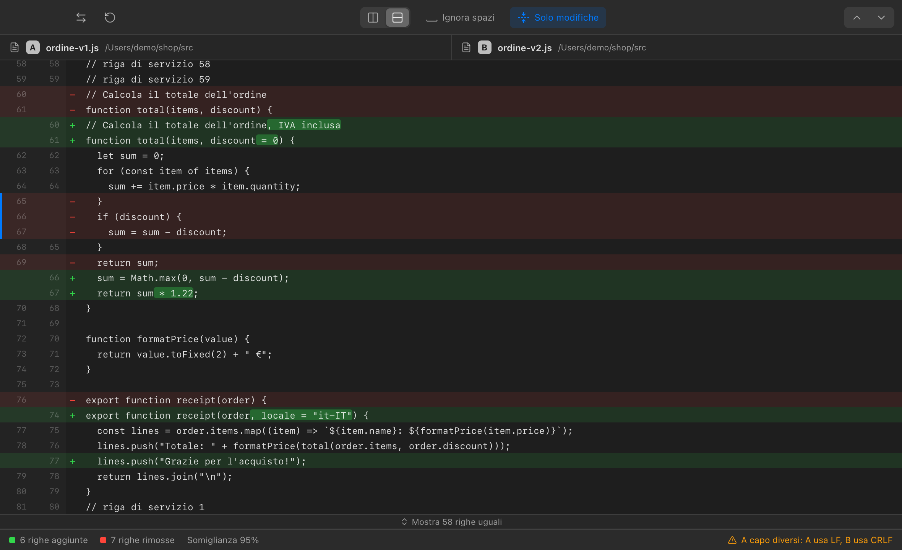

# diffdrop

[English](README.md) · **Italiano**

diffdrop confronta due file di testo. Trascina un file a sinistra (A, originale) e uno a destra (B, modificato): il confronto parte da solo. È un'app desktop per macOS e Windows, fatta con [Tauri 2](https://v2.tauri.app), con il motore di diff in Rust.







## Funzioni

- Due zone, A e B. Fai clic su una zona per scegliere il file; se trascini due file insieme, il primo va in A e il secondo in B.
- Diff riga per riga, con le parole cambiate evidenziate dentro le righe modificate.
- Vista affiancata (le due colonne scorrono insieme) o unificata, con i numeri di riga.
- *Solo modifiche*: le righe uguali si comprimono lasciando 3 righe di contesto, con un pulsante per espanderle.
- *Ignora spazi*, scambio di A e B, ricomincia, navigazione tra le modifiche.
- Statistiche: righe aggiunte, righe rimosse, somiglianza, e un avviso se i file usano a capo diversi (CRLF / LF).
- I file binari vengono riconosciuti e segnalati. Il testo può essere UTF-8, UTF-16 o Windows-1252.
- Se un file cambia sul disco, il confronto si aggiorna da solo.
- Fluida anche con file da 100.000 righe: il diff si calcola in Rust su un thread separato e si disegnano solo le righe visibili.
- Interfaccia in italiano e in inglese, tema chiaro e scuro che segue il sistema.

## Aprire i file

- **Trascinandoli** sulla finestra, oppure con un clic su una zona.
- **macOS**: trascinali sull'icona nel Dock, oppure usa *Apri con → diffdrop* nel Finder.
- **Windows**: in Esplora file usa *Apri con → Scegli un'altra app* e seleziona `diffdrop.exe`. L'installer non registra associazioni di file, così diffdrop non diventa mai l'app predefinita per i tuoi file di testo.
- **Riga di comando**: `diffdrop fileA fileB`. Se diffdrop è già aperta, i file vanno nella finestra già aperta.

Per usare il comando `diffdrop` dal terminale:

- macOS: `sudo ln -s /Applications/diffdrop.app/Contents/MacOS/diffdrop /usr/local/bin/diffdrop`
- Windows: aggiungi alla variabile d'ambiente `PATH` la cartella che contiene `diffdrop.exe` (di solito dentro `%LOCALAPPDATA%`).

## Scorciatoie da tastiera

| macOS | Windows | Azione |
| --- | --- | --- |
| ⌘O | Ctrl+O | Apri uno o due file |
| ⌘⇧S | Ctrl+Maiusc+S | Scambia A e B |
| ⌘↓ | Ctrl+↓ | Modifica successiva |
| ⌘↑ | Ctrl+↑ | Modifica precedente |

## Compilare

Servono [Rust](https://rustup.rs) 1.90 o successivo, [Node.js](https://nodejs.org) 20.19+ o 22.12+, e i [prerequisiti di sistema di Tauri](https://v2.tauri.app/start/prerequisites/) (Xcode Command Line Tools su macOS; Microsoft C++ Build Tools e WebView2 su Windows).

```sh
npm ci                 # installa le dipendenze del frontend
npm run tauri dev      # avvia in modalità sviluppo
cargo test             # esegue i test del motore di diff
npm run tauri build    # compila l'app e l'installer
```

Gli installer finiscono in `target/release/bundle/`. Per una build universale per macOS (Apple Silicon + Intel):

```sh
rustup target add aarch64-apple-darwin x86_64-apple-darwin
npm run tauri build -- --target universal-apple-darwin
```

## Release e firma

Il [workflow Release](.github/workflows/release.yml) parte quando pubblichi una release su GitHub. Compila un `.dmg` universale e un installer per Windows e li allega alla release.

La firma è facoltativa e si attiva quando esistono questi secret nel repository:

- **macOS** (certificato Developer ID, notarizzazione con Apple ID): `APPLE_CERTIFICATE` (il `.p12` in base64), `APPLE_CERTIFICATE_PASSWORD`, `APPLE_SIGNING_IDENTITY` (es. `Developer ID Application: Nome (TEAMID)`), `APPLE_ID`, `APPLE_PASSWORD` (una password specifica per app), `APPLE_TEAM_ID`, `KEYCHAIN_PASSWORD` (una password qualsiasi per il portachiavi temporaneo).
- **Windows**: `WINDOWS_CERTIFICATE` (il `.pfx` in base64) e `WINDOWS_CERTIFICATE_PASSWORD`.

Senza questi secret gli installer vengono compilati senza firma. Le entitlement per l'hardened runtime sono in `src-tauri/Entitlements.plist`.

## Struttura del progetto

```
crates/diff-core/   motore di diff (niente interfaccia): decodifica, diff di righe e parole, statistiche, test
src-tauri/          backend Tauri: comandi, menu, finestra, controllo dei file
src/                frontend (Vite + TypeScript): zone di drop, toolbar, vista del diff virtualizzata
locales/            testi dell'interfaccia, condivisi tra frontend e menu nativo
```

## Licenza

[MIT](LICENSE)
