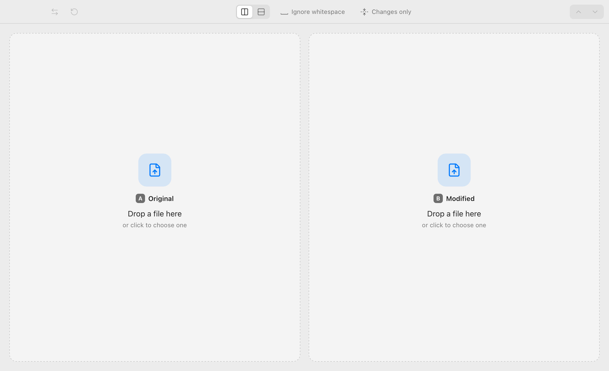
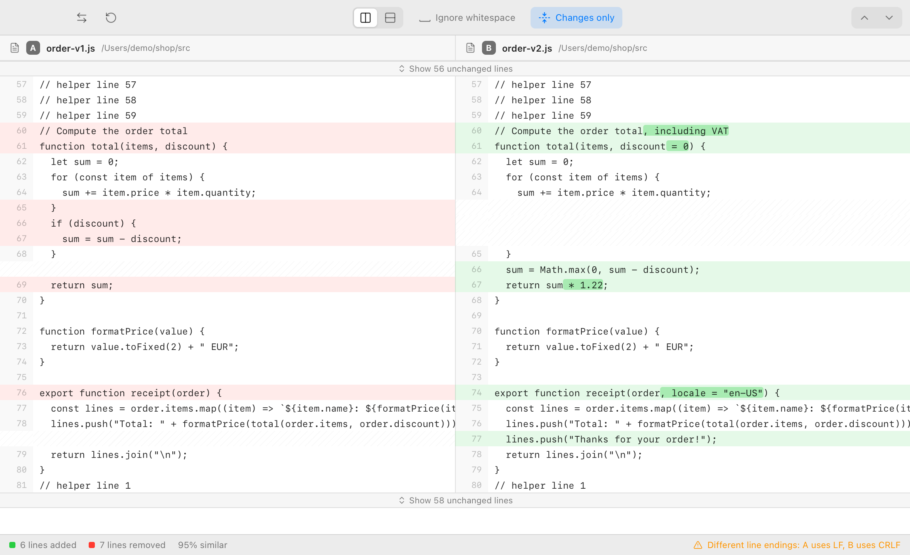
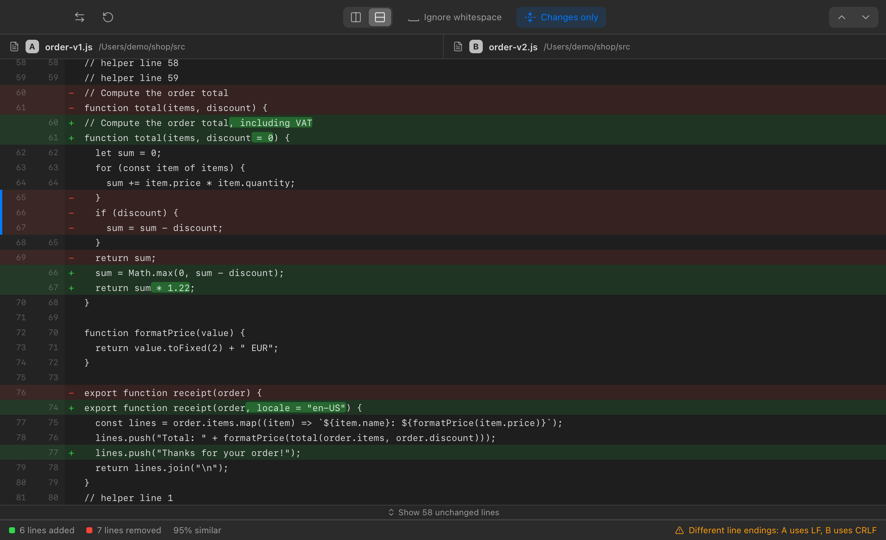

# diffdrop

**English** · [Italiano](README.it.md)

diffdrop compares two text files. Drop one file on the left (A, original) and one on the right (B, modified): the comparison starts on its own. It is a desktop app for macOS and Windows, built with [Tauri 2](https://v2.tauri.app), with a Rust diff engine.







## Features

- Two drop zones, A and B. Click a zone to choose a file; drag two files at once and the first goes to A, the second to B.
- Line by line diff with the changed words highlighted inside modified lines.
- Side by side view (both columns scroll together) or unified view, with line numbers.
- *Changes only*: unchanged runs fold down to 3 lines of context, with a button to expand them.
- *Ignore whitespace*, swap A and B, start over, jump between changes.
- Statistics: lines added, lines removed, similarity, and a warning when the files use different line endings (CRLF / LF).
- Binary files are detected and reported. Text can be UTF-8, UTF-16 or Windows-1252.
- When a file changes on disk, the comparison updates by itself.
- Smooth with files of 100,000 lines: the diff runs in Rust on a worker thread and only the visible rows are drawn.
- English and Italian interface, light and dark theme following the system.

## Opening files

- **Drag and drop** onto the window, or click a zone.
- **macOS**: drop files on the Dock icon, or use *Open With → diffdrop* in Finder.
- **Windows**: in Explorer use *Open with → Choose another app* and pick `diffdrop.exe`. The installer does not register file associations, so diffdrop never becomes the default app for your text files.
- **Command line**: `diffdrop fileA fileB`. If diffdrop is already open, the files go to the window that is already open.

To use the `diffdrop` command from a terminal:

- macOS: `sudo ln -s /Applications/diffdrop.app/Contents/MacOS/diffdrop /usr/local/bin/diffdrop`
- Windows: add the folder that contains `diffdrop.exe` (by default inside `%LOCALAPPDATA%`) to the `PATH` environment variable.

## Keyboard shortcuts

| macOS | Windows | Action |
| --- | --- | --- |
| ⌘O | Ctrl+O | Open one or two files |
| ⌘⇧S | Ctrl+Shift+S | Swap A and B |
| ⌘↓ | Ctrl+↓ | Next change |
| ⌘↑ | Ctrl+↑ | Previous change |

## Building

Requirements: [Rust](https://rustup.rs) 1.90 or newer, [Node.js](https://nodejs.org) 20.19+ or 22.12+, and the [Tauri system prerequisites](https://v2.tauri.app/start/prerequisites/) (Xcode Command Line Tools on macOS; Microsoft C++ Build Tools and WebView2 on Windows).

```sh
npm ci                 # install the frontend dependencies
npm run tauri dev      # run in development mode
cargo test             # run the diff engine tests
npm run tauri build    # build the app and the installer
```

The installers end up in `target/release/bundle/`. For a universal macOS build (Apple Silicon + Intel):

```sh
rustup target add aarch64-apple-darwin x86_64-apple-darwin
npm run tauri build -- --target universal-apple-darwin
```

## Releases and signing

The [Release workflow](.github/workflows/release.yml) runs when a GitHub release is published. It builds a universal `.dmg` and a Windows installer and attaches them to the release.

Signing is optional and turns on when these repository secrets exist:

- **macOS** (Developer ID certificate, notarization with an Apple ID): `APPLE_CERTIFICATE` (the `.p12` in base64), `APPLE_CERTIFICATE_PASSWORD`, `APPLE_SIGNING_IDENTITY` (e.g. `Developer ID Application: Name (TEAMID)`), `APPLE_ID`, `APPLE_PASSWORD` (an app-specific password), `APPLE_TEAM_ID`, `KEYCHAIN_PASSWORD` (any password for the temporary keychain).
- **Windows**: `WINDOWS_CERTIFICATE` (the `.pfx` in base64) and `WINDOWS_CERTIFICATE_PASSWORD`.

Without them, the installers are built unsigned. The hardened runtime entitlements are in `src-tauri/Entitlements.plist`.

## Project layout

```
crates/diff-core/   diff engine (no UI code): decoding, line and word diff, stats, tests
src-tauri/          Tauri backend: commands, menu, window, file watching
src/                frontend (Vite + TypeScript): drop zones, toolbar, virtualized diff view
locales/            interface strings, shared by the frontend and the native menu
```

## License

[MIT](LICENSE)
